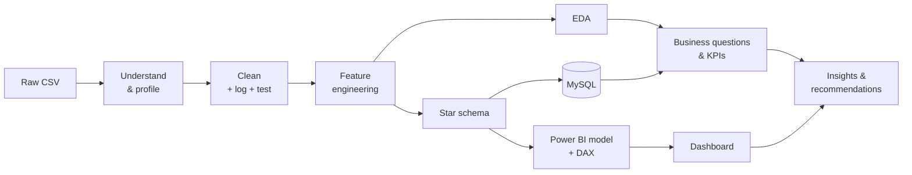
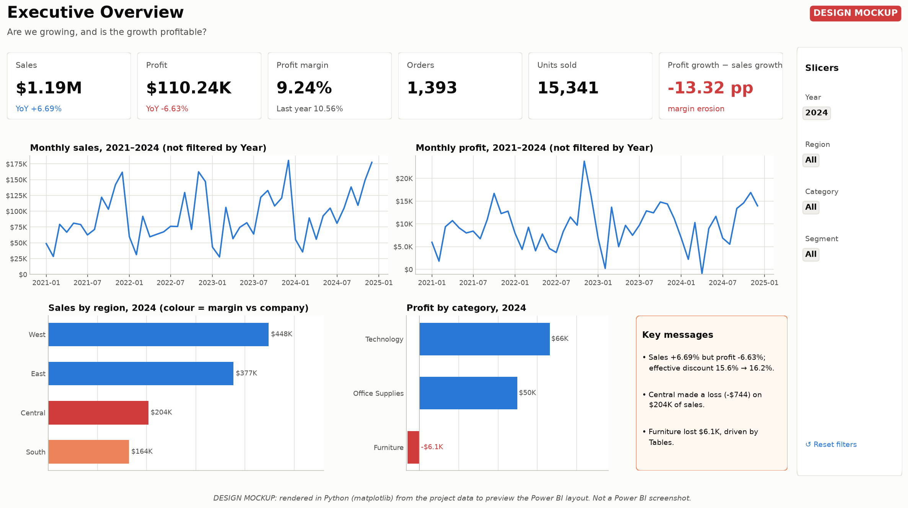
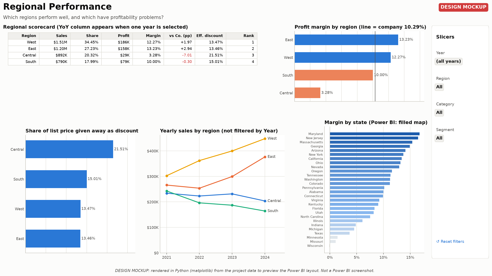
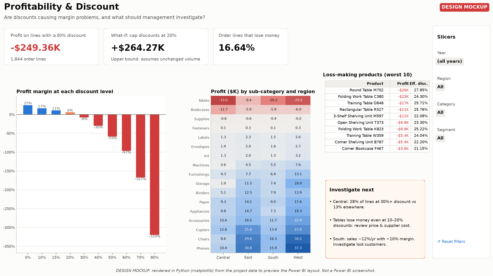

# Regional Sales Performance Analysis and Visualization

**End-to-end analytics project: messy sales export → tested Python cleaning → EDA → MySQL star schema → Power BI model, DAX and dashboard design → business recommendations.**

    

---

## Overview

RetailCo (a fictional US retailer) grew sales in 2024, but profit fell. This project analyses **4 years of order data (11.5k order lines, 5,190 orders, 4 regions)** to find out where the company makes money, where it loses money, and what management should do about it.

> **Headline finding:** in 2024 sales grew **+6.7%** while profit fell **−6.6%**. The loss of profit traces back to **deep discounting**, concentrated in the **Central region** and in **Tables & Bookcases**. Every discount of 30% or more is loss-making, costing **$249K** over four years.


## Project status

The analytical pipeline and dashboard specification are fully reproducible. The Power BI report is designed for final assembly in Power BI Desktop, because Power BI Desktop is Windows-only. The `.pbix` file is therefore **not yet included**.

### ✅ Verified (executed in this repository)
| Area | Evidence |
|---|---|
| **Python pipeline** | `python src/pipeline.py --regenerate` rebuilds everything from scratch (raw → clean → star schema → 13 charts) |
| **Cleaning** | 11,567 → 11,461 rows, 275 values repaired; checked against the generator's ground truth |
| **Tests** | `python tests/test_pipeline.py`: 10/10 pass (also on pandas 2.2) |
| **EDA & business analysis** | 4 notebooks execute top to bottom with 0 errors |
| **SQL** | 4 scripts run on MySQL 8.0 with 0 errors; totals match Python to the cent |
| **Documentation** | Numbers checked by script against the data; all internal links resolve; DAX column names match the CSV headers |

### 🪟 Requires Windows / Power BI Desktop
| Item | Prepared for it |
|---|---|
| `.pbix` report | [Power BI Master Guide](powerbi/POWER_BI_MASTER_GUIDE.md): click-by-click, from a blank report to 5 pages |
| DAX execution (31 measures) | [DAX validation checklist](powerbi/DAX_VALIDATION_CHECKLIST.md): expected value for every measure, from Python/SQL |
| Dashboard screenshots | [Final validation procedure](powerbi/FINAL_VALIDATION.md), then screenshots into `screenshots/`. Until then: [design mockups](powerbi/mockups/) rendered in Python from the same data, clearly labelled as mockups |

## Business problem

> *"We've grown sales again this year, but Finance says profit is down and nobody can tell me why."* (Head of Sales)

Existing reports showed revenue only. Leadership needed profitability by region, product and customer, an interactive dashboard, and recommendations. [Full scenario & stakeholders →](docs/company_scenario.md)

## Objectives

1. Build a clean, trustworthy dataset, with every cleaning decision logged and **tested**.
2. Compare regions on **sales, profit and margin**.
3. Find the best and worst products, customers and segments.
4. Measure growth, decline and seasonality.
5. Explain what drives profitability (discounts, product mix, region).
6. Deliver KPIs, a Power BI data model, DAX measures and a 5-page dashboard design.
7. Turn the findings into recommendations with owners and KPIs.

## Tech stack

| Tool | Used for |
|---|---|
| **Python** (pandas, NumPy) | Data generation, cleaning, validation, feature engineering, automation |
| **Matplotlib / Seaborn** | EDA charts (13, each tied to one business question) |
| **Jupyter** | 4 explanatory notebooks |
| **MySQL 8** | Star schema with PK/FK/CHECK constraints, data-quality and analysis queries (CTEs, window functions) |
| **Power BI** (Power Query, DAX) | Data model, 31 measures incl. time intelligence, 5-page dashboard design (build in Power BI Desktop pending) |
| **Git / GitHub** | Version control and documentation |

[Why each tool, and how they connect →](docs/technology_connections.md)

## Dataset

* **11,567 raw rows → 11,461 clean rows**, 19 original + 13 engineered columns, Jan 2021 – Dec 2024.
* Same column layout as the public *Superstore* dataset (Order, Customer, Region, Product, Sales, Quantity, Discount, Profit…).
* **Synthetic and documented:** generated by [`src/generate_data.py`](src/generate_data.py) from explicit business rules, with **realistic, known data-quality errors injected** (duplicates, typos, missing values, `"$1,234"` text, impossible dates…). Because the error-free version exists, the cleaning is **verified against ground truth** by [`tests/test_pipeline.py`](tests/test_pipeline.py).

[Data dictionary →](docs/data_dictionary.md)

## Important note about the dataset

This project uses a **reproducible, synthetic Superstore-style dataset generated specifically for the project.** It is not data from a real company.

Why:
* **Reproducibility:** a fixed random seed means anyone who runs `python src/pipeline.py --regenerate` gets byte-identical files (verified on pandas 2.2 and 3.0).
* **Controlled data-quality issues:** 11 kinds of realistic errors are injected on purpose, so the cleaning step has genuine work to do.
* **Verifiable cleaning:** the error-free version is known, so tests can prove that every repaired value is correct. That is impossible with real-world data.
* **No proprietary data:** nothing confidential, so the whole repository can be public.

**The business findings below describe this synthetic dataset.** Its patterns come from rules written openly in the generator (regional growth rates, discount habits, product margins, seasonality). They demonstrate the analytical method and **should not be read as findings about a real company**. The pipeline uses the Superstore column layout, so it can be pointed at real data without code changes.

## Project architecture



[How every stage connects (beginner-friendly, follows one real order line) →](docs/end_to_end_logic.md) · [Technical architecture →](docs/architecture.md)

## Repository structure

```
regional-sales-performance-analysis/
├── README.md                   ← you are here
├── START_HERE.md               ← beginner guide: the whole project from zero
├── INTERVIEW_GUIDE.md          ← pitches + 90 interview Q&As
├── PROJECT_CHECKLIST.md        ← what is verified, what is still manual
├── data/
│   ├── raw/sales_raw.csv               (messy export, 11,567 rows)
│   └── processed/
│       ├── sales_cleaned.csv           (11,461 rows × 32 cols)
│       ├── cleaning_log.csv            (every cleaning step, before/after)
│       └── powerbi/                    (FactSales + 4 dimension CSVs)
├── notebooks/
│   ├── 01_data_understanding.ipynb
│   ├── 02_data_cleaning.ipynb
│   ├── 03_eda.ipynb
│   └── 04_business_analysis.ipynb
├── src/
│   ├── generate_data.py        (synthetic data with documented rules)
│   ├── data_cleaning.py        (ordered, logged cleaning steps + validation)
│   ├── feature_engineering.py
│   ├── eda.py                  (summary tables + chart functions)
│   ├── build_star_schema.py
│   ├── pipeline.py             (runs everything end to end)
│   ├── dashboard_mockups.py    (renders the Power BI design mockups)
│   └── utils.py
├── tests/test_pipeline.py      (10 tests: cleaning vs ground truth, documented numbers)
├── sql/
│   ├── schema.sql              (DB, star schema, constraints, CSV load, view)
│   ├── data_quality.sql        (profiling the raw data in SQL)
│   ├── sales_analysis.sql      (SELECT → JOIN → CASE → CTE → window functions)
│   └── business_queries.sql    (management questions)
├── powerbi/
│   ├── POWER_BI_MASTER_GUIDE.md     (THE build guide: blank report → 5 pages)
│   ├── DAX_VALIDATION_CHECKLIST.md  (31 measures: expected result + how to validate)
│   ├── FINAL_VALIDATION.md          (4-level proof: data, model, DAX, dashboard)
│   ├── POWER_BI_TROUBLESHOOTING.md  (symptom → cause → fix → verify)
│   ├── POWER_BI_STEP_BY_STEP.md     (Power BI concepts for beginners)
│   ├── mockups/                     (6 dashboard DESIGN MOCKUPS rendered in Python, not screenshots)
│   ├── Data_Model.md                (star schema, relationships, Power Query M)
│   ├── DAX_Measures.md              (31 measures explained line by line)
│   └── Dashboard_Design.md          (5 pages: questions, visuals, validation values)
├── reports/
│   ├── Executive_Summary.md
│   ├── Business_Insights.md
│   ├── EDA_Report.md
│   └── Project_Report.md
├── docs/
│   ├── end_to_end_logic.md     (how every stage connects)
│   ├── architecture.md         (technical layout, modules, verification)
│   ├── data_dictionary.md
│   ├── company_scenario.md     (RetailCo + stakeholders)
│   ├── technology_connections.md
│   ├── project_story.md        (the project as a spoken story)
│   ├── PLACEMENT_READINESS.md  (skills, likely questions, 90-second answer)
│   ├── INTERVIEW_MASTER_SHEET.md (one-page-per-topic revision sheet)
│   ├── resume_bullets.md
│   ├── GITHUB_PROFILE_TEXT.md  (repo description, topics, LinkedIn text)
│   └── GITHUB_PUBLISHING.md
├── visualizations/             (13 charts)
├── screenshots/                (Power BI screenshots go here once built)
├── requirements.txt
├── .gitignore / .gitattributes
└── LICENSE
```

## Data cleaning

| | Rows |
|---|---|
| Raw | 11,567 |
| Exact duplicates removed | −70 |
| Invalid order dates removed | −5 |
| Missing Sales/Profit removed (cannot be rebuilt) | −17 |
| Sales ≤ 0 or Quantity ≤ 0 removed | −14 |
| **Clean** | **11,461 (99.1% kept)** |

**275 values repaired instead of deleted.** Region was rebuilt from State, names from IDs, `"$1,277.10"` converted to a number, and `20` read as a 20% discount. Outliers were **flagged, not removed**: they are real copiers and furniture, worth 42% of revenue. [Every decision and its reason →](notebooks/02_data_cleaning.ipynb)

## EDA

13 charts, each answering one question. Bars compare regions, lines show trends, a scatter finds high-sales/low-profit products, and a heatmap locates the losses. No dual axes and no decorative charts. [EDA report →](reports/EDA_Report.md)

| | |
|---|---|
|  |  |

## KPIs

| Total Sales | Total Profit | Margin | Orders | AOV | Sales YoY 2024 | Profit YoY 2024 |
|---|---|---|---|---|---|---|
| $4.39M | $452K | 10.3% | 5,190 | $846 | **+6.7%** | **−6.6%** |

Every KPI is defined with its formula, meaning and limitations, and **reconciled to the cent between Python and MySQL**. The same values are the expected results for the DAX measures.

## SQL

Four MySQL 8 scripts, **executed on a MySQL 8.0 server with 0 errors** (strict mode, `ONLY_FULL_GROUP_BY`):

| Script | What it shows |
|---|---|
| [`schema.sql`](sql/schema.sql) | Star schema with primary keys, foreign keys and `CHECK` constraints; `LOAD DATA` of the CSVs; a reporting view |
| [`data_quality.sql`](sql/data_quality.sql) | Profiling the raw data in SQL: missing values, duplicates, invalid dates and values |
| [`sales_analysis.sql`](sql/sales_analysis.sql) | Teaching order: `SELECT/WHERE` → `JOIN/GROUP BY/HAVING` → `CASE` → CTEs → window functions (`LAG`, `RANK`, running totals) |
| [`business_queries.sql`](sql/business_queries.sql) | Management questions: regional YoY, growth without profit, loss-making products, `NTILE` quartiles, customer concentration |

Headline results are identical to the Python output (e.g. total sales 4,391,176.00; 5,190 orders; Central margin 3.28%).

## Power BI dashboard

> **Status:** fully specified, ready for assembly in Power BI Desktop (Windows-only). The `.pbix`, the DAX execution and the screenshots are the remaining manual step (see [Project status](#project-status)).

**Star schema** (`FactSales` + `DimDate`, `DimCustomer`, `DimProduct`, `DimGeography`) with 31 DAX measures, including `SAMEPERIODLASTYEAR` YoY (guarded with `HASONEVALUE`), `RANKX` ranking, a weighted effective-discount measure and a what-if measure.

| Page | Answers |
|---|---|
| 1 · Executive Overview | Are we growing, and is it profitable? |
| 2 · Regional Performance | Which regions are strong or weak, and why? |
| 3 · Product Performance | Which products make or lose money? |
| 4 · Customer Performance | Who are the most valuable customers? |
| 5 · Profitability & Discount | Where and why is profit leaking? |

[Master guide](powerbi/POWER_BI_MASTER_GUIDE.md) · [Final validation](powerbi/FINAL_VALIDATION.md) · [Troubleshooting](powerbi/POWER_BI_TROUBLESHOOTING.md) · [Model](powerbi/Data_Model.md) · [DAX](powerbi/DAX_Measures.md) · [Validation](powerbi/DAX_VALIDATION_CHECKLIST.md) · [Dashboard spec](powerbi/Dashboard_Design.md)

## Key insights (synthetic dataset)

1. **Growth without profit:** 2024 sales +6.7%, profit −6.6%; margin fell to 9.2%.
2. **Central** has 20% of sales but only 6% of profit (3.3% margin). It gives the deepest discounts in 15 of 17 sub-categories; on normally discounted lines its margin matches the other regions.
3. **Tables (−$91.5K) and Bookcases (−$30.4K)** lose money in *every* region, leaving Furniture break-even on $1.45M of sales.
4. **Discounts ≥ 30% are always loss-making** (−$249K); the correlation between discount and margin is −0.81.
5. **South** is shrinking (−12%/yr) but profitable, so this is a volume problem, not a price problem.
6. **West & East** deliver all of the growth and 76% of profit.

[Insights written as fact → explanation → investigation → action →](reports/Business_Insights.md)

## Business recommendations

1. Require approval for discounts ≥ 30%, **piloted in Central** (measure margin *and* volume).
2. Re-price or renegotiate costs for Tables and Bookcases.
3. Put margin, not just revenue, into sales targets.
4. Run a customer-retention review in the South before spending on promotions.
5. Protect West/East capacity ahead of the Sep–Dec peak (Q4 = 37% of sales).

**Opportunity:** up to **$264K** extra profit if 30%+ discounts had been 20% at unchanged volume. This is an upper bound, clearly labelled as such. [Executive summary →](reports/Executive_Summary.md)

## Limitations

* **Synthetic data:** findings illustrate the method; they are not facts about a real company.
* **Costs:** only cost of goods is modelled. Shipping, returns and overheads are not included.
* **Causation:** the analysis shows associations. *Why* Central discounts more needs business input.
* **What-if:** the $264K assumes unchanged volume, so it is an upper bound, not a forecast.
* **No targets or budgets:** performance is compared across regions and years, not against a plan.
* **Power BI:** the report is specified but not yet built or validated in Power BI Desktop.

## How to run the project

```bash
git clone <repository-url>
cd regional-sales-performance-analysis
python -m venv .venv
source .venv/bin/activate          # Windows: .venv\Scripts\activate
pip install -r requirements.txt

python src/pipeline.py --regenerate   # raw data → clean data → star schema → charts
python tests/test_pipeline.py         # verify cleaning against ground truth (10 tests)
python src/dashboard_mockups.py       # optional: re-render the dashboard design mockups
jupyter notebook notebooks/           # read the notebooks in order 01 → 04
```

**SQL (MySQL 8):** from the project root, run `mysql --local-infile=1 -u root -p < sql/schema.sql`, then the other three scripts.
Tested with Python 3.12 on pandas 3.0 and pandas 2.2.

**Power BI (Windows):** follow [POWER_BI_MASTER_GUIDE.md](powerbi/POWER_BI_MASTER_GUIDE.md), then [FINAL_VALIDATION.md](powerbi/FINAL_VALIDATION.md).

## Screenshots

**Dashboard design mockups:** rendered in Python from the project data to preview the Power BI layout. **These are not Power BI screenshots** (see [Project status](#project-status)); every image carries a "DESIGN MOCKUP" banner. All 6 pages: [`powerbi/mockups/`](powerbi/mockups/).



| | |
|---|---|
|  |  |

EDA charts are in [`visualizations/`](visualizations/). Real Power BI screenshots go in [`screenshots/`](screenshots/) once the `.pbix` is built.

## Future improvements

* Run the same pipeline on a real dataset (e.g. Superstore); no code changes needed.
* Add returns and shipping costs for full profitability.
* Add a sales-targets fact table for plan-vs-actual reporting.
* Design an A/B test for the discount cap; forecast sales by region; RFM customer segmentation.
* Schedule the pipeline and the Power BI Service refresh.

## Interview relevance

The project is built to be explained in an interview, with honest answers to the hard questions ("Isn't your data synthetic?", "Is that correlation or causation?", "How do you know your cleaning is right?"):
* [INTERVIEW_GUIDE.md](INTERVIEW_GUIDE.md): 30-second to 5-minute pitches, 90 Q&As, what you can and cannot claim
* [docs/PLACEMENT_READINESS.md](docs/PLACEMENT_READINESS.md): likely and difficult questions, learning checklist, 90-second answer
* [docs/INTERVIEW_MASTER_SHEET.md](docs/INTERVIEW_MASTER_SHEET.md): concise revision sheet, including the hardest questions
* [docs/project_story.md](docs/project_story.md) · [docs/resume_bullets.md](docs/resume_bullets.md)

## Skills demonstrated

`Python` `pandas` `NumPy` `data cleaning` `data validation & testing` `EDA` `Matplotlib` `Seaborn` `descriptive statistics` `correlation` `SQL` `CTEs` `window functions` `star schema` `data modeling` `Power Query` `DAX` `time intelligence` `KPI design` `dashboard design` `data storytelling` `business analysis` `Git`

## Author

**Charan Teja**
<!-- Add your links before publishing, e.g. [LinkedIn](https://www.linkedin.com/in/...) · [GitHub](https://github.com/...) -->

Licensed under the [MIT License](LICENSE).
