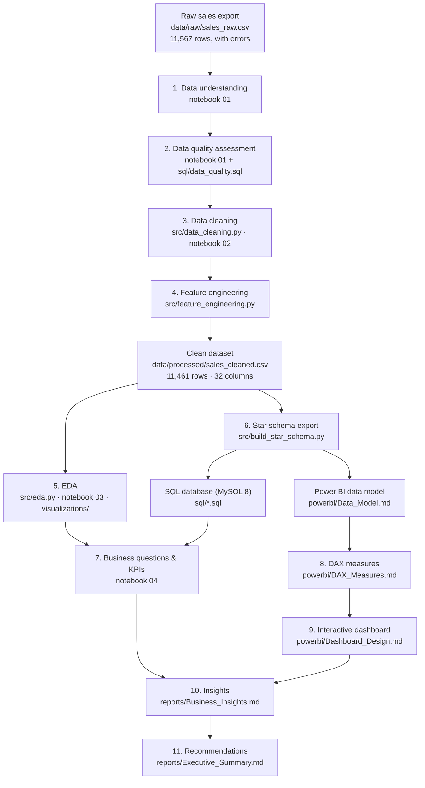

# Project Architecture

## The pipeline at a glance



**One command reproduces everything from raw data to charts:**

```bash
python src/pipeline.py --regenerate   # generate -> clean -> features -> star schema -> charts
python tests/test_pipeline.py         # prove the cleaning is correct
```

---

## What each stage does and why

The stage-by-stage explanation (what enters, what happens, what comes out, why the stage exists, and how the next stage uses it) is in **[end_to_end_logic.md](end_to_end_logic.md)**. It follows one real order line from the raw file to the final recommendation. This page covers only the technical layout.

---

## Code modules

| Module | Responsibility | Used by |
|---|---|---|
| `src/utils.py` | Paths, reference data (valid regions, State→Region), chart style | everything |
| `src/generate_data.py` | Builds the synthetic raw dataset | pipeline, tests |
| `src/data_cleaning.py` | Cleaning steps + log + validation | notebook 02, pipeline, tests |
| `src/feature_engineering.py` | Derived columns, weighted margin helper | notebook 02, pipeline |
| `src/eda.py` | Summary tables + chart functions | notebooks 03/04, pipeline |
| `src/build_star_schema.py` | Fact/dimension split + integrity checks | pipeline, tests |
| `src/pipeline.py` | Runs everything in order | command line |
| `src/dashboard_mockups.py` | Renders Python design mockups of the 5 Power BI pages + Region Detail (not screenshots) | command line |
| `tests/test_pipeline.py` | Proves cleaning against ground truth | command line / pytest |

**Why modules *and* notebooks?** Notebooks are for explaining and exploring. Modules are for logic that must be correct, reusable and testable. The notebooks import the modules, so explanation and pipeline code can never drift apart.

---

## Verification built into the architecture

| Check | Where | What it proves |
|---|---|---|
| 10 automated tests | `tests/test_pipeline.py` | Cleaning recovers the true values; no rows invented; headline numbers unchanged |
| Python vs SQL reconciliation | `sql/*.sql` on MySQL 8 | Two engines give identical totals to the cent |
| DAX expected values | `powerbi/DAX_VALIDATION_CHECKLIST.md` | What each measure must show in Power BI *(Power BI Desktop validation required)* |
