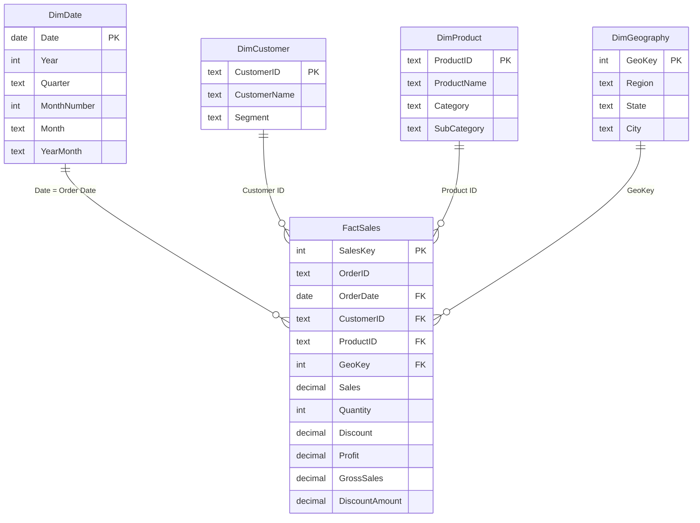

# Power BI Data Model & Power Query

This document explains **how the data is shaped for Power BI** and **why**. Click-by-click instructions: [POWER_BI_MASTER_GUIDE.md](POWER_BI_MASTER_GUIDE.md). Report design: [Dashboard_Design.md](Dashboard_Design.md). Measures: [DAX_Measures.md](DAX_Measures.md).

> ⚠️ Power BI Desktop validation required: the M code and model below have not yet been run in Power BI Desktop.

---

## 1. Key words first

| Term | Meaning | Example here |
|---|---|---|
| **Fact table** | Stores *events* and their numbers. Long and narrow: many rows, mostly keys and numbers | `FactSales`: one row per order line, with Sales, Profit, Quantity |
| **Dimension table** | Stores *descriptions* used to filter and group. Short and wide | `DimProduct`: name, category, sub-category |
| **Primary key (PK)** | Column whose value is unique in its table; identifies one row | `DimProduct[Product ID]` |
| **Foreign key (FK)** | Column in the fact table that points to a dimension's PK | `FactSales[Product ID]` |
| **Relationship** | A link PK ↔ FK that lets a filter on one table affect another | Selecting "Technology" filters FactSales |
| **Cardinality** | How many rows match on each side | **One-to-many (1:\*)**: one product → many sales lines |
| **Filter direction** | Which way filters flow across a relationship | **Single**: from dimension → fact |
| **Star schema** | One fact table in the middle, dimensions around it, like a star | See diagram below |

---

## 2. The model



| Relationship | Cardinality | Filter direction | Active |
|---|---|---|---|
| `DimDate[Date]` → `FactSales[Order Date]` | 1 : * | Single | ✅ |
| `DimCustomer[Customer ID]` → `FactSales[Customer ID]` | 1 : * | Single | ✅ |
| `DimProduct[Product ID]` → `FactSales[Product ID]` | 1 : * | Single | ✅ |
| `DimGeography[GeoKey]` → `FactSales[GeoKey]` | 1 : * | Single | ✅ |
| *(optional)* `DimDate[Date]` → `FactSales[Ship Date]` | 1 : * | Single | ❌ inactive, used with `USERELATIONSHIP` for shipping analysis |

**Why relate on `Date` and not `DateKey`?** Both work. Relating on the real date column means time-intelligence functions such as `SAMEPERIODLASTYEAR` work directly. `DateKey` (an integer like 20240131) is kept for the SQL version of the model.

**Mark `DimDate` as a date table:** *Table tools → Mark as date table → Date*. This tells Power BI the table is a complete calendar, which time intelligence needs.

---

## 3. Why a star schema instead of one big table?

| | One flat table | **Star schema (chosen)** |
|---|---|---|
| Ease for a beginner | Easiest: import and go | One extra step (relationships) |
| Storage | Repeats "Technology", customer names etc. on every row | Each description stored once |
| Time intelligence | Needs a separate date table anyway | Proper `DimDate`, marked as date table |
| Filter behaviour | Fine for simple use | Predictable: dimension → fact, single direction |
| Adding a new data source (e.g. sales **targets** by region and month) | Hard: targets don't fit the order-line grain | Easy: new fact table shares `DimDate` and `DimGeography` |
| Performance at scale | Wider, slower to scan | What the VertiPaq engine is optimised for |

**Trade-off honestly stated:** at 11k rows a flat table would perform fine. The star schema is chosen because it is the **professional standard**. It is required for correct time intelligence, and it scales when new facts such as targets or returns are added.

**Why single-direction filters?** Bi-directional filters can create *ambiguous paths* (two routes between tables) and slow the model. All our questions flow naturally from "pick a dimension value → see the facts", so single direction is correct.

---

## 4. Power Query: what it is and where it fits

```
Raw data (CSV / database)
   → Power Query   (shape the TABLES: types, columns, rows, merges)  — runs at REFRESH time
   → Data Model    (tables + relationships)
   → DAX           (calculate NUMBERS that react to filters)         — runs at QUERY time, every click
   → Visuals       (charts, cards, slicers)
```

| Tool | Best for | Runs when | In this project |
|---|---|---|---|
| **Python (pandas)** | Complex cleaning, validation, statistics, reproducible pipelines, testing | Before Power BI, on demand | All cleaning, feature engineering, star-schema export, EDA |
| **Power Query (M)** | Repeatable *shaping* inside Power BI: data types, renaming, merging, filtering, when no separate pipeline exists | On dataset refresh | Import CSVs, set data types, (alternative) build dimensions from the flat file |
| **DAX** | Calculations that must respond to slicers: totals, ratios, YoY, ranking | Every time a visual is drawn | All KPIs and measures |

**Rule of thumb:** do work **as far upstream as possible**. Shaping belongs in Python/SQL/Power Query; *dynamic* maths belongs in DAX. A ratio such as margin **must** be DAX, because it has to be recalculated for whatever the user selects.

### 4a. Recommended route: import the star-schema CSVs

1. *Home → Transform data → Manage parameters → New parameter* `DataFolder` (Text) = full path to `data/processed/powerbi/` **with a trailing slash**.
2. *Get data → Blank query* → *Advanced editor*, paste one query per table (example for `FactSales`):

```m
let
    Source   = Csv.Document(
                   File.Contents(DataFolder & "FactSales.csv"),
                   [Delimiter = ",", Encoding = 65001, QuoteStyle = QuoteStyle.Csv]),
    Promoted = Table.PromoteHeaders(Source, [PromoteAllScalars = true]),
    Typed    = Table.TransformColumnTypes(Promoted, {
                   {"SalesKey", Int64.Type}, {"Order ID", type text},
                   {"OrderDateKey", Int64.Type},
                   {"Order Date", type date}, {"Ship Date", type date},
                   {"Ship Mode", type text}, {"Customer ID", type text},
                   {"Product ID", type text}, {"GeoKey", Int64.Type},
                   {"Sales", Currency.Type}, {"Quantity", Int64.Type},
                   {"Discount", type number}, {"Profit", Currency.Type},
                   {"Gross Sales", Currency.Type}, {"Discount Amount", Currency.Type},
                   {"Shipping Days", Int64.Type}}, "en-US")
in
    Typed
```

```m
// DimDate
let
    Source   = Csv.Document(File.Contents(DataFolder & "DimDate.csv"),
                   [Delimiter = ",", Encoding = 65001, QuoteStyle = QuoteStyle.Csv]),
    Promoted = Table.PromoteHeaders(Source, [PromoteAllScalars = true]),
    Typed    = Table.TransformColumnTypes(Promoted, {
                   {"DateKey", Int64.Type}, {"Date", type date}, {"Year", Int64.Type},
                   {"Quarter", type text}, {"Month Number", Int64.Type},
                   {"Month", type text}, {"Year-Month", type text},
                   {"Weekday", type text}, {"Is Weekend", type logical}}, "en-US")
in
    Typed
```

`DimCustomer`, `DimProduct` and `DimGeography` follow the same pattern (all text columns, except `GeoKey` as `Int64.Type`).

**Blank values:** 6 rows have an empty `Ship Date` and `Shipping Days` (their source ship date was impossible; see notebook 02). They should load as **null**. If Power Query shows *Error* in those cells instead, select both columns → *Transform → Replace Errors* → leave the value empty (null).

3. **Sort `DimDate[Month]` by `DimDate[Month Number]`** (*Column tools → Sort by column*). Otherwise months appear alphabetically: Apr, Aug, Dec…
4. **Add a map-safe location column to `DimGeography`.** In Power Query select `DimGeography` → *Add Column → Custom Column*, name `State Location`, formula `[State] & ", United States"`. Then set its data category to **Place** (*Column tools → Data category*).
   *Why:* a bare "Georgia" can be placed in the **country** Georgia; "Georgia, United States" cannot be misread. Also set `[State]` to "State or Province" and `[City]` to "City".
5. Hide key columns from report view (right-click → *Hide in report view*): `FactSales[SalesKey]`, `[OrderDateKey]`, `[GeoKey]`, `[Customer ID]`, `[Product ID]`, `[Order Date]`, `DimDate[DateKey]`, `DimGeography[GeoKey]`. Users then only see the friendly fields in the dimensions, and can't accidentally use `FactSales[Order Date]` instead of `DimDate`.
6. Create the relationships in *Model view* as in the table above.

### 4b. Alternative route: build the star schema *inside* Power Query

Useful to demonstrate Power Query skills, or when there is no Python step:

1. Import `data/processed/sales_cleaned.csv` as `Sales` and disable its load (*right-click → Enable load* off).
2. *Reference* `Sales` → keep `Product ID, Product Name, Category, Sub-Category` → *Remove duplicates* on `Product ID` → name it `DimProduct`.
3. Repeat for `DimCustomer` (`Customer ID`, `Customer Name`, `Segment`) and `DimGeography` (`Region, State, City`, then *Add column → Index column* starting at 1 as `GeoKey`).
4. *Reference* `Sales` → *Merge queries* with `DimGeography` on `State + City` → expand `GeoKey` → remove descriptive columns → `FactSales`.
5. Create `DimDate` with DAX instead (it is simpler):

```dax
DimDate =
ADDCOLUMNS (
    CALENDAR ( DATE ( 2021, 1, 1 ), DATE ( 2024, 12, 31 ) ),
    "Year", YEAR ( [Date] ),
    "Quarter", "Q" & QUARTER ( [Date] ),
    "Month Number", MONTH ( [Date] ),
    "Month", FORMAT ( [Date], "mmm" ),
    "Year-Month", FORMAT ( [Date], "yyyy-mm" )
)
```

**Trade-off:** route 4a keeps all transformation logic in one tested place (Python). Route 4b keeps everything inside the `.pbix`, which is convenient for a self-service analyst, but that logic cannot easily be unit-tested.

---

## 5. Validating the model

After loading, a card with `[Total Sales]` and no filters must show **$4,391,176.00**, and `[Total Orders]` must show **5,190**. Both match the Python pipeline and `sql/sales_analysis.sql` (query A1). If they don't, check:

* Data types: `Sales` must be Decimal/Currency, not Text.
* Relationships: one-to-many, single direction, and `DimDate` marked as a date table.
* That no table was filtered in Power Query by mistake. Row counts should be FactSales 11,461 · DimDate 1,461 · DimCustomer 741 · DimProduct 174 · DimGeography 36.
