# EDA Report

**Data:** 11,461 clean order lines · 5,190 orders · 741 customers · 2021-01-01 to 2024-12-31
**Source notebook:** [`notebooks/03_eda.ipynb`](../notebooks/03_eda.ipynb) · **Charts:** [`visualizations/`](../visualizations/)
**Rule:** all ratios are weighted, i.e. margin = SUM(Profit) / SUM(Sales).

> The dataset is synthetic (see [data dictionary](../docs/data_dictionary.md#why-synthetic-data)). The findings demonstrate the analytical method; they are not claims about a real company.

## Headline numbers

| KPI | Value |
|---|---|
| Total Sales | $4,391,176 |
| Total Profit | $452,068 |
| Profit Margin | 10.3% |
| Orders | 5,190 |
| Units sold | 56,703 |
| Average Order Value | $846 |
| 2024 vs 2023 | Sales **+6.7%**, Profit **−6.6%** |

**Shape of the data:** line-level sales are right-skewed (median $139, mean $383). A minority of high-value lines (8.9% of lines) carries 42% of revenue. They are genuine products (copiers, phones, chairs, tables) and were kept.

---

## 1. Regional performance

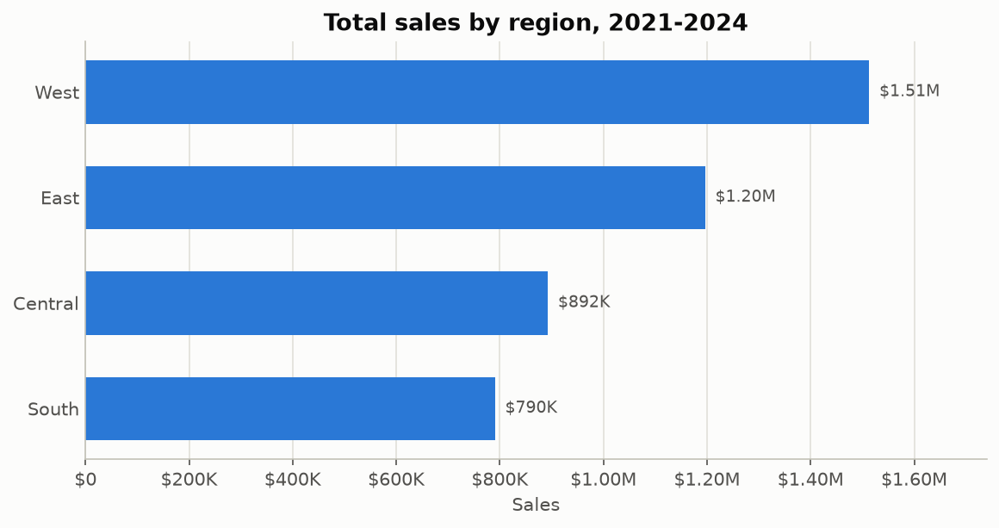
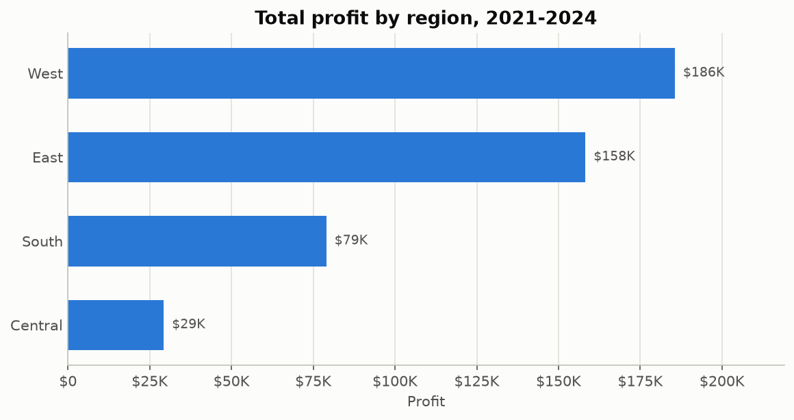
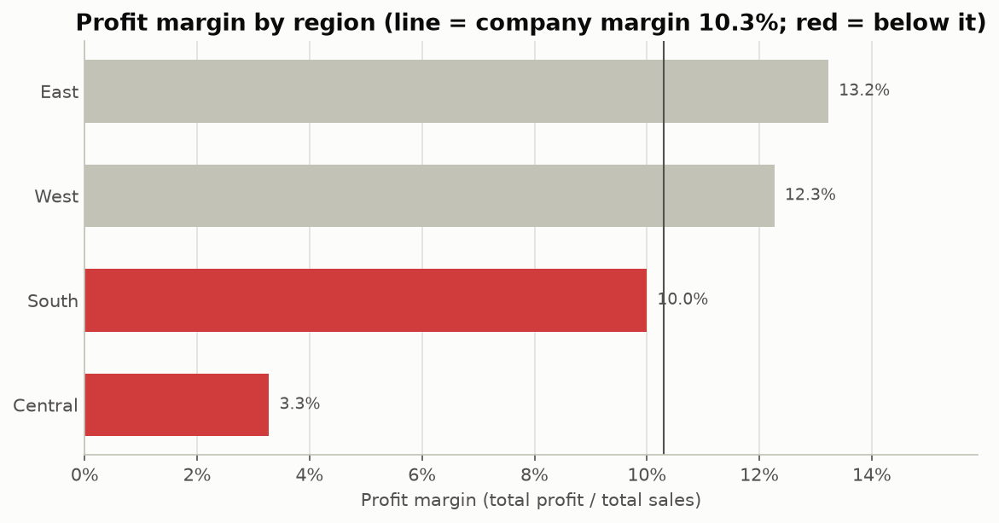

| Region | Sales | Share | Profit | Margin | Effective discount |
|---|---|---|---|---|---|
| West | $1,512,745 | 34.45% | $185,570 | 12.3% | 13.5% |
| East | $1,195,925 | 27.2% | $158,222 | **13.2%** | 13.5% |
| Central | $892,318 | 20.3% | $29,295 | **3.3%** | **21.5%** |
| South | $790,187 | 18.0% | $78,982 | 10.0% | 15.0% |

**Chart choice:** bar charts, because we are comparing one number across a few categories. The margin chart has a reference line at the company margin, so "above or below average" needs no arithmetic.

**Observed:** West leads in sales and profit. Central is third in sales but last in profit, with a margin about a quarter of East's.

## 2. Time

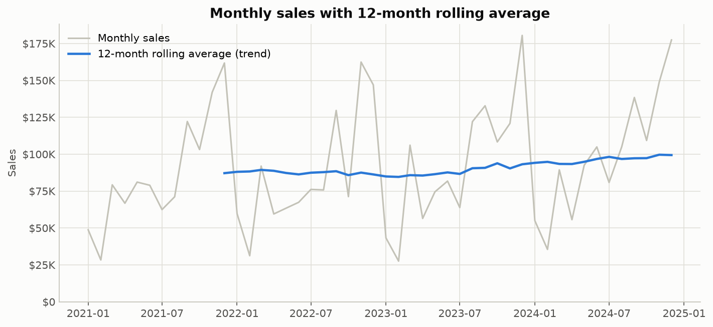
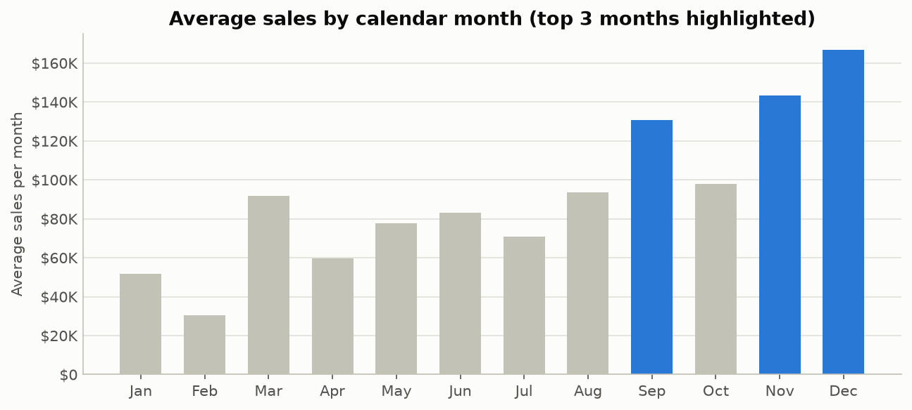
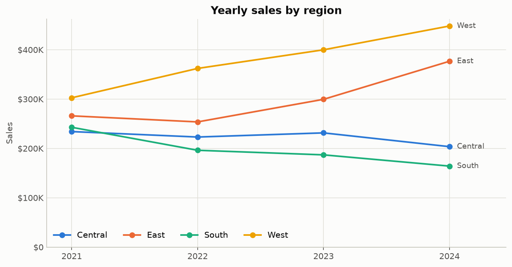

| Year | Sales | YoY | Profit | YoY | Margin |
|---|---|---|---|---|---|
| 2021 | $1,045,576 | — | $112,678 | — | 10.8% |
| 2022 | $1,035,180 | −1.0% | $111,077 | −1.4% | 10.7% |
| 2023 | $1,117,830 | +8.0% | $118,071 | +6.3% | 10.6% |
| 2024 | $1,192,591 | +6.7% | $110,242 | **−6.6%** | **9.2%** |

| Region | Sales CAGR 2021–24 | 2024 YoY |
|---|---|---|
| West | +14.0% | +12.1% |
| East | +12.3% | +25.8% |
| Central | −4.5% | −12.1% |
| South | **−12.2%** | −12.2% |

**Chart choice:** a line chart for time. A 12-month rolling average separates the trend from the strong seasonality. Seasonality is shown as *average* sales per calendar month, so one big year can't dominate.

**Observed:**
* Strong seasonality: December (index 182), November (157) and September (143) are the peaks; February (34) is the weakest month. Q4 ≈ 37% of annual sales.
* Growth since 2023 comes entirely from West and East. South has declined every year.
* Margin has slipped every year, and fell sharply in 2024.

## 3. Products

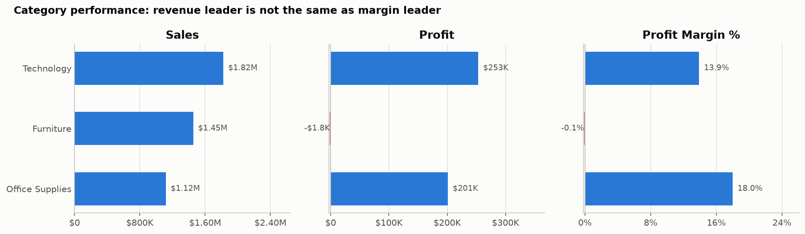
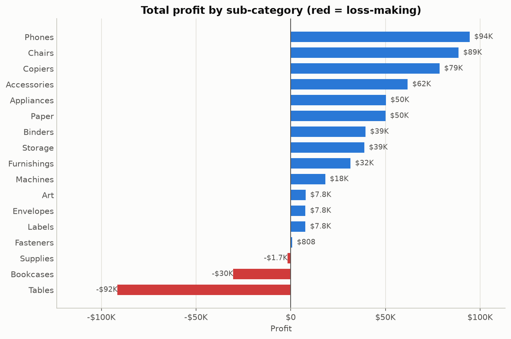
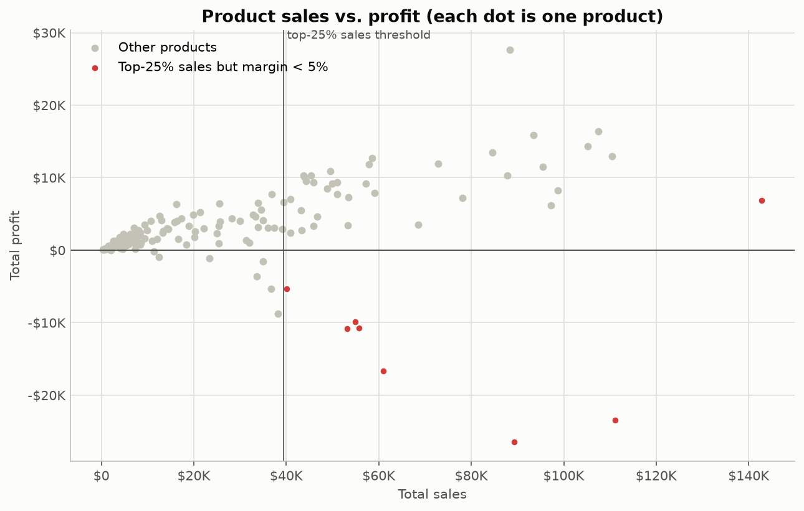

| Category | Sales | Profit | Margin |
|---|---|---|---|
| Technology | $1,821,186 | $252,949 | 13.9% |
| Furniture | $1,452,790 | **−$1,797** | **−0.1%** |
| Office Supplies | $1,117,200 | $200,917 | **18.0%** |

* **Most profitable sub-categories:** Phones ($94.4K), Chairs ($88.6K), Copiers ($78.6K). Highest margin: Paper (37.8%).
* **Loss-making:** Tables (−$91.5K, −23.3%), Bookcases (−$30.4K, −13.0%), Supplies (−$1.7K).
* **High sales / low profit** (top 25% by sales, margin < 5%): 8 products, 7 of them tables or bookcases, together −$97K. The best-selling product (*Orbit Smartphone L502*, $143K) earns only a 4.8% margin.

**Chart choice:** the category view uses three side-by-side panels instead of a dual-axis chart, which would imply a relationship that is only an artefact of the scales. The product scatter puts the two measures on two axes, so the "high sales, negative profit" corner becomes visible.

## 4. Customers

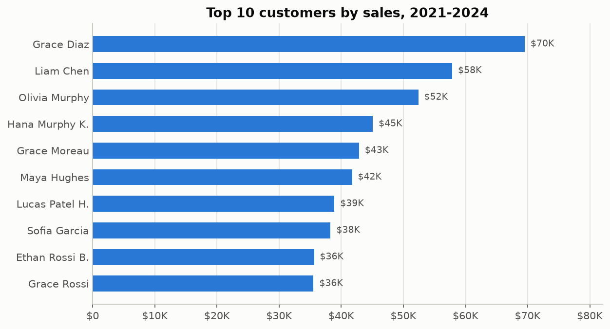
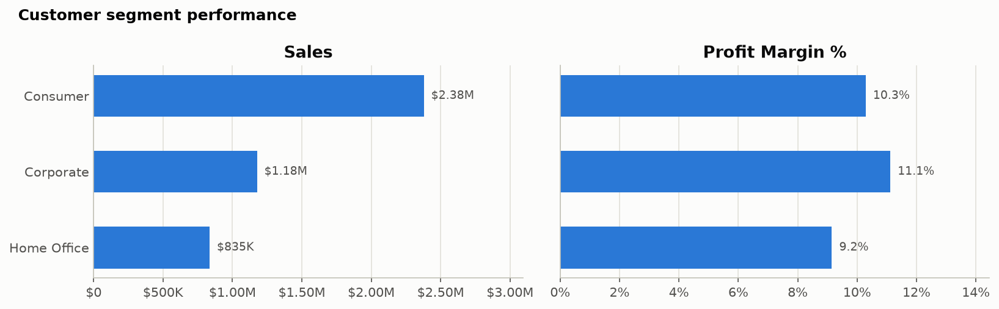

* Top customer: $69.5K over four years. The top 10 customers ≈ 10% of sales.
* **Concentration:** top 10% of customers = 36.8% of sales; top 20% = 54.3%.
* High revenue ≠ high profit: one top-10 customer ($41.7K sales) has a 1.1% margin.
* Segments: Consumer 54.2% of sales; Corporate has the best margin (11.1%), Home Office the lowest (9.2%). The spread is small: segment is not the main profitability driver.

## 5. Discounts and profitability

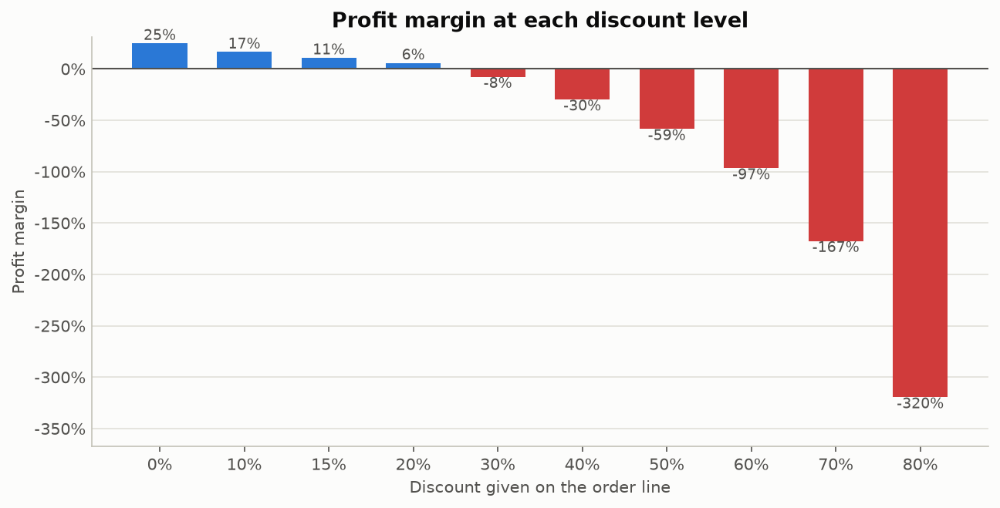
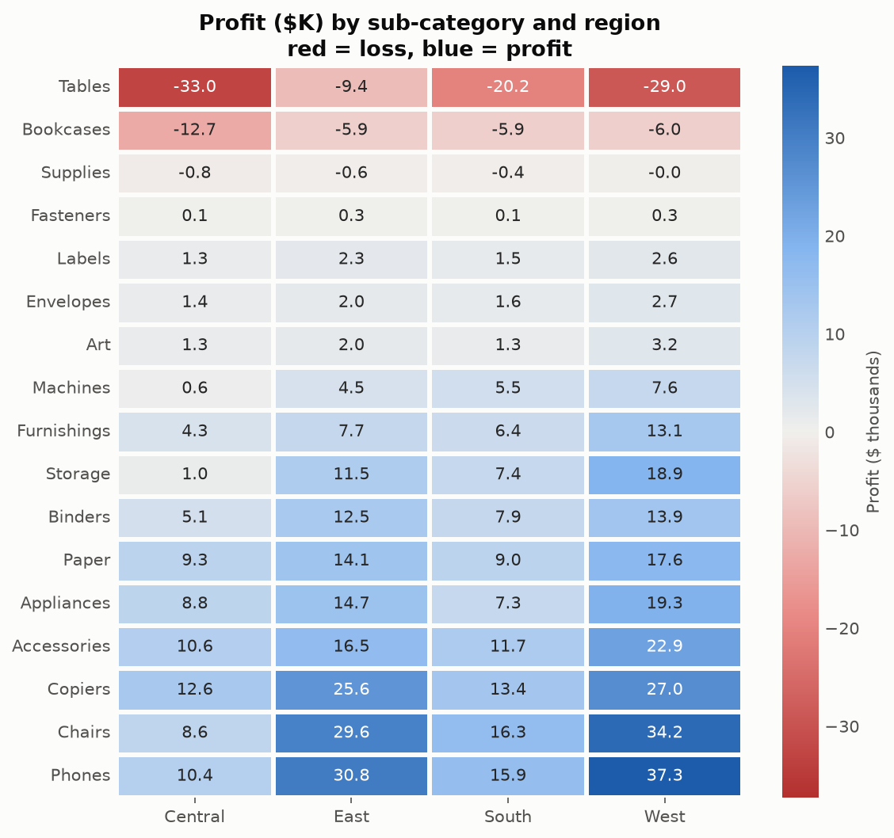

| Discount | Margin | Lines loss-making |
|---|---|---|
| 0% | 24.9% | 0% |
| 10% | 16.5% | 3% |
| 20% | 5.8% | 11% |
| 30% | −7.7% | 51% |
| 40% | −29.8% | 83% |
| 50%+ | −59% to −320% | 95–100% |

* Correlation between discount and line margin: **Pearson −0.81, Spearman −0.72** (a strong negative association).
* All lines with ≥ 30% discount together: 10.6% of sales, **−$249K profit**.
* Central discounts most in **15 of 17 sub-categories**, and 28% of its lines carry 30%+ discounts (vs ~13% elsewhere). On lines with < 30% discount, Central's margin (17.4%) is close to the other regions' (18.0%).
* Tables lose money in **every** region, which points to a product-level problem as well as a regional one.

**Chart choice:** discount has 10 discrete levels, so an ordered bar chart of the *aggregated* margin per level is clearer than a scatter of 11,000 overlapping points. The heatmap uses a diverging red–grey–blue scale centred on zero, with values printed in each cell so that colour is never the only cue.

## What EDA does *not* tell us

* **Why** Central discounts more (pricing authority? incentives? competition?): this needs business input.
* How customers would react to smaller discounts (price elasticity): this needs a controlled test.
* Costs beyond cost of goods (shipping, returns, overheads), which are not in the data.

➡ Continued in [Business_Insights.md](Business_Insights.md).
